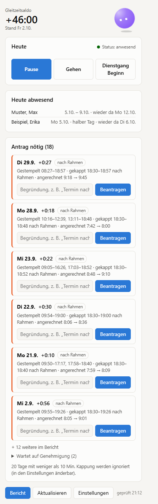
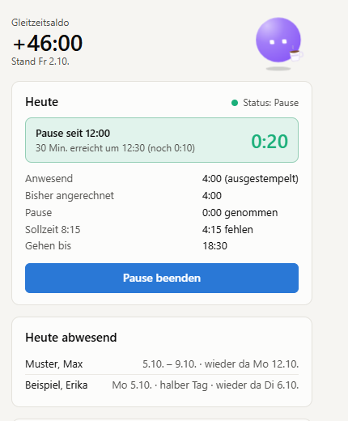
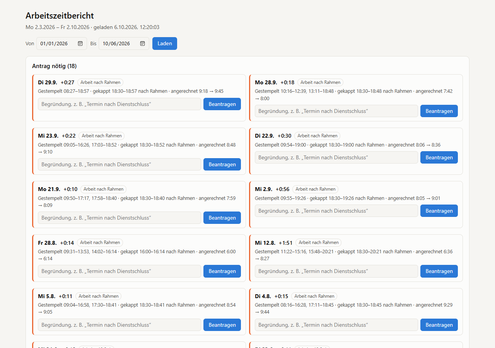
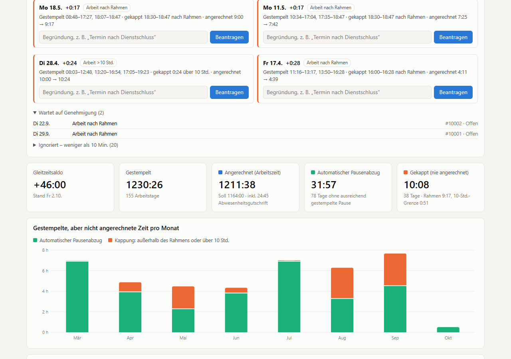
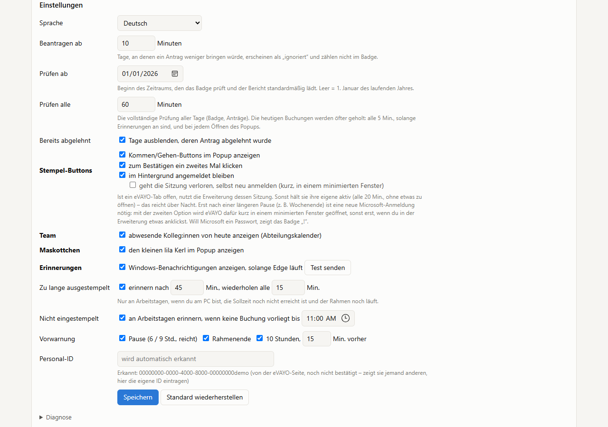

<p align="center">
  
</p>

<h1 align="center">GLAZ-Buddy</h1>

<p align="center">
  An Edge extension that makes <b>eVAYO</b> time tracking readable and takes care of the
  tedious parts: what was really credited, which days still need a permission request, Kommen/Gehen
  with one click, and reminders when you forget to clock back in.
</p>

> Unofficial personal project. Not affiliated with or endorsed by the vendor of eVAYO.
> Works with any eVAYO installation: the address of your instance is set up once in the extension
> (or taken from an open eVAYO tab) and only the same web APIs the eVAYO web app uses are called
> with your own login.
>
> **This repository only distributes the signed build.** Source code, docs and tests:
> [Zuescho/glaz-buddy](https://github.com/Zuescho/glaz-buddy) (GNU GPL v3).

## What it does

| | |
|---|---|
| **Popup** | Flexitime balance (Saldo), today at a glance (credited so far, a live break timer, when the time frame ends), Kommen / Pause / Gehen / Dienstgang buttons, colleagues absent today, and the days that still need a request. |
| **Requests in one step** | For every day where clocked time was cut, the needed permissions ("Arbeit nach Rahmen", "Arbeit vor Rahmen", "Arbeit >10 Std.") are chosen automatically - you only type the reason. A minimum (default 10 min) hides tiny cuts. |
| **Full report** | Clocked vs. credited time, automatic break deductions, cut time, approved overtime, Saldo over time, every single day - plus all open, ignored, rejected and hidden requests. |
| **Reminders** | Windows notifications when you're still clocked out after a break, your break is long enough, you haven't clocked in yet, a break is due (6 h / 9 h), the time frame ends soon or you reach 10 hours. |
| **Badge** | Number of days that need attention, right on the toolbar icon. |
| **Deutsch / English** | Full translation, switchable in the settings. |
| **The buddy** | A sleepy purple clay bot that follows your mouse, holds a coffee on breaks, carries a briefcase on a Dienstgang, bursts into stars when your target is reached - and has a few easter eggs. |

## Screenshots

<p>
  
  &nbsp;
  
</p>







<sub>Screenshots are generated offline from recorded data with personal identifiers replaced.</sub>

## Files

| File | Purpose |
|------|---------|
| `glaz-buddy.crx` | Signed, packed extension (created by `tools/pack.ps1` in the source repo) |
| `updates.xml` | Update manifest Edge polls: app ID, CRX URL, version |
| `extension-id.txt` | Extension ID as plain text |

The private signing key is **not** here; it stays with the owner. It fixes the extension ID
`ijhbmofnkgedjfknliopndpofmeddonp`.

## Install

### With a group policy (admins)

Force-install it from this repository. Set a registry string under

```
HKLM\SOFTWARE\Policies\Microsoft\Edge\ExtensionInstallForcelist
```

with any name (e.g. `1`) and this value:

```
ijhbmofnkgedjfknliopndpofmeddonp;https://raw.githubusercontent.com/Zuescho/glaz-buddy-publish/main/updates.xml
```

Restart Edge. The policy installs the extension and users cannot remove it; the first start asks for
the eVAYO address (or takes it from an open eVAYO tab).

### For a single user (no admin, no GPO)

Edge reads the same policy from the current user's registry. Open PowerShell and run:

```powershell
irm https://raw.githubusercontent.com/Zuescho/glaz-buddy/main/tools/install-policy.ps1 | iex
```

The script writes the value to `HKCU\SOFTWARE\Policies\Microsoft\Edge\ExtensionInstallForcelist`
and leaves other extensions' entries alone (review it at that URL first if you like). Restart Edge,
open `edge://policy` and press **Reload policies**: GLAZ-Buddy installs itself from the update URL
and updates by itself from then on. Remove it with

```powershell
irm https://raw.githubusercontent.com/Zuescho/glaz-buddy/main/tools/uninstall-policy.ps1 | iex
```

<details>
<summary>Manual registry value</summary>

```powershell
$k = 'HKCU:\SOFTWARE\Policies\Microsoft\Edge\ExtensionInstallForcelist'
if (-not (Test-Path $k)) { New-Item $k | Out-Null }
New-ItemProperty $k -Name 1 -PropertyType String -Force -Value 'ijhbmofnkgedjfknliopndpofmeddonp;https://raw.githubusercontent.com/Zuescho/glaz-buddy-publish/main/updates.xml'
```

Use the next free number if a value named `1` already holds another extension.
</details>

A machine-wide policy (GPO or `HKLM`) wins over the per-user entry. If the folder was loaded unpacked
before, remove that copy in `edge://extensions` first - one extension ID cannot be installed twice.

### Without policy (development)

Clone [Zuescho/glaz-buddy](https://github.com/Zuescho/glaz-buddy), then
`edge://extensions` → **Developer mode** → **Load unpacked** → the `extension` folder. Update with
**Reload** (the popup also reloads itself when it notices a newer background part).

## Updates

Every release replaces `glaz-buddy.crx` with a higher `version` and pushes it together with
`updates.xml`. Edge reads `updates.xml` (at start and every few hours), downloads the new CRX and
installs it on its own - no click, no profile restart.

The policy's update check runs unauthenticated: **this repository must stay public**.

## Privacy

- Everything stays in your Edge profile (`chrome.storage.local`): the eVAYO tokens, your employee ID
  and a cache of daily evaluations. The extension talks only to the eVAYO address you configured.
- Colleagues' absences come from the department calendar exactly as eVAYO shows them (masked as
  "xx" by the server) - only "absent" and the date range are displayed, never a reason.
- No tokens, keys or personal data are in this repository - only the packed build.

## Uninstall

Remove the policy value (GPO, or the per-user one-liner above) and restart Edge. A copy loaded
unpacked is removed in `edge://extensions`.

## Credits

The buddy is a "Grok bot"-style clay avatar designed and exported by the repo owner with the
community tool at [grokbots.ai/studio](https://grokbots.ai/studio) (purple, sleepy face), animated
here. That tool is an independent community project, not affiliated with X Corp or xAI.

## License

GNU General Public License v3.0 - see [LICENSE](LICENSE) and the
[source repository](https://github.com/Zuescho/glaz-buddy). Free software: you may redistribute it
and/or modify it under the terms of the GPL, version 3. No warranty; use at your own risk.
